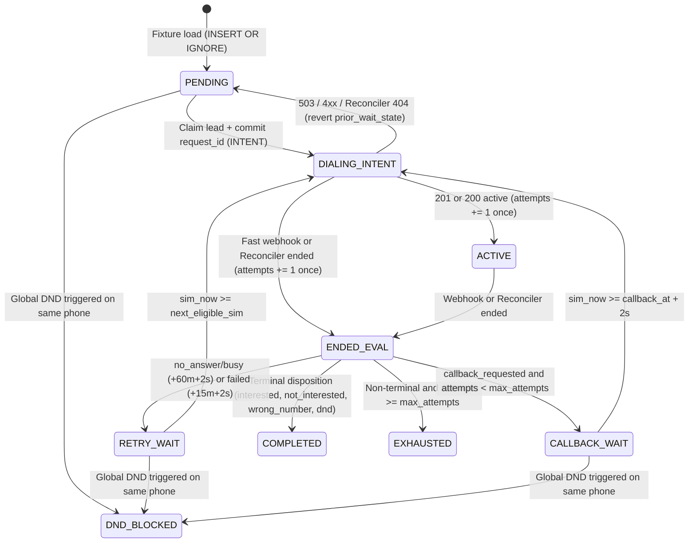

# Submission

## Candidate
- **Name:** siddhugitty153
- **Assignment chosen:** B (Workflow) — Durable Campaign Dispatcher
- **Time spent (honest estimate):** ~5h

## How to run
```bash
# 1. Install dependencies (Python 3.11+)
pip install -r requirements.txt

# 2. Run unit tests (fake clock; does not wait on mock_telephony)
pytest solution/tests -v

# 3. Terminal 1: start the mock telephony provider
cd assignment-b-workflow
python -m mock_telephony --speed 600 --seed 7

# 4. Terminal 2: start the durable dispatcher (from repo root)
cd ..
PYTHONPATH=solution python -m dispatcher \
  --fixtures assignment-b-workflow/fixtures/campaigns.json \
  --db dispatcher.db \
  --output final_state.csv \
  --provider-url http://127.0.0.1:8099 \
  --port 8200
```
The dispatcher runs until every lead reaches a terminal state (`completed`, `exhausted`, or `dnd_blocked`), writes `final_state.csv` atomically, and exits with status `0`. If killed (`kill -9` / `TerminateProcess`) and restarted with the same `--db`, it reconciles in-flight `INTENT`/`ACTIVE` calls and resumes without double-dialling or losing leads.

## Design

### Architecture
The service runs as a single Python process in `solution/dispatcher/` combining:
1. **FastAPI Webhook & Observability Server** (`main.py`):
   - `POST /webhooks/telephony` verifies `X-AU-Signature` (hex HMAC-SHA256 of the raw request body using `webhook_secret` from `campaigns.json`), idempotently applies `process_call_completion()`, and wakes the scheduler immediately.
   - `GET /status` and `GET /health` expose per-campaign lead progress, active/intent calls, DND count, and simulated clock time.
2. **SQLite WAL Transactional State Machine** (`db.py`, `engine.py`):
   - Uses SQLite in `WAL` mode (`synchronous=NORMAL`, `busy_timeout=5000`) serialized via an `RLock` + `BEGIN IMMEDIATE` transactions.
   - Idempotent fixture loading (`INSERT OR IGNORE` for leads) ensures restarts never overwrite existing lead states or attempt counts.
3. **Simulated Clock & Window Math** (`clock.py`):
   - Syncs `sim_epoch`, `real_epoch`, and `speed` from `GET /v1/clock` and projects `sim_now` locally.
   - Enforces `[window_start, window_end) ∩ [09:00, 21:00)` IST on allowed weekdays with a speed-scaled closing buffer (`max(60.0, min(1800.0, speed * 1.5))` simulated seconds) so high-speed clock ticks or carrier latency never cross window close.
4. **Startup & Periodic Reconciler** (`main.py`, `engine.py`):
   - Before dialling any new lead on startup, and every `0.3s` in the background (or immediately on `504` / HTTP error), queries `GET /v1/calls?request_id=...` for any `INTENT`/`ACTIVE` attempt not currently in-flight in memory.
5. **Atomic CSV Exporter** (`exporter.py`):
   - Writes `final_state.csv` sorted by `(campaign_id, lead_id)` via temporary file + `os.replace`.

### Lead State Machine


### Guaranteeing At-Most-Once Dialling (Two-Phase Intent Ledger)
Every dial uses a two-phase commit pattern keyed by `request_id` (generated before touching the network):
1. Inside `BEGIN IMMEDIATE`, `claim_next_eligible_lead()` checks tenant concurrency (`INTENT + ACTIVE < max_concurrent_calls`), per-phone exclusivity (`phone NOT IN (INTENT, ACTIVE)`), `dnd_registry`, `attempts < max_attempts`, and `CALLBACK_WAIT > RETRY_WAIT > PENDING` ordering. It inserts a `call_attempts` row with `state='INTENT', counted_attempt=0` and moves the lead to `DIALING_INTENT` before releasing the transaction.
2. Only after the SQLite commit succeeds does `place_call_task()` issue `POST /v1/calls` with that `request_id`.
3. `counted_attempt` ensures `leads.attempts` is incremented at most once regardless of whether `201`, a fast webhook, or the reconciler settles the call first.

## Decisions & assumptions

| Decision | Why | Alternative considered |
|---|---|---|
| SQLite WAL (`BEGIN IMMEDIATE`) over Temporal | Zero external daemon dependencies, single-transaction atomicity across tenant concurrency (R2), per-phone lock (R3), and global DND (R8), plus deterministic `kill -9` recovery. | Temporal (`temporalio` + dev server) or Postgres + Celery. |
| Key calls by pre-committed `request_id` instead of `call_sid` | Webhooks can arrive before `POST /v1/calls` returns `201` (or `504` hides `call_sid`), so `request_id` is the only stable correlation key across crashes and races. | In-memory map keyed by `call_sid` (breaks on fast webhooks and `kill -9`). |
| Reconcile ambiguous `504`/crash `INTENT`s via `GET /v1/calls?request_id=...` before re-dialling | `GET` never places a call outside a closed calling window; if `404`, reverting to `prior_wait_state` lets the scheduler re-evaluate window and DND rules safely. | Blindly retrying `POST /v1/calls` with the same `request_id` on startup (risks `422 outside_calling_window` if window just closed). |
| Speed-scaled closing buffer `max(60s, min(1800s, speed * 1.5))` + `+2s` eligibility buffer | At `600x–1200x`, per-request client overhead in the mock carrier can stall its event loop briefly; a ~1.5 real-second cushion prevents window/early-retry `422`s. | Fixed `45s` buffer (too small at `1200x+` when carrier event loop stalls). |
| Deterministic SQL priority query instead of LLM/agent selection | R1–R9 are strict rules and 1 real second = 10–20 simulated minutes; LLM latency would cause callback lateness and window violations. | Agentic prioritization loop. |

## Failure modes considered
- **Crash (`kill -9`) between claim and `POST /v1/calls` or before `201`:** `INTENT` remains on disk holding the concurrency and phone locks. On restart, startup reconciliation waits up to `0.2s` from `created_real_ts` (so any pre-crash TCP packet is processed by the provider), then queries `GET /v1/calls?request_id=...` and either reverts (`404`), promotes to `ACTIVE`, or processes completion (`ended`).
- **`504` Gateway Timeout (call may or may not exist):** Treated identically to an interrupted `INTENT`; `reconcile_event` immediately triggers `GET /v1/calls?request_id=...`.
- **`503` Service Unavailable:** Call was not placed; reverts `INTENT` to `ABORTED` and restores `prior_wait_state` without incrementing `attempts`.
- **Webhook arrives before `201` response:** `process_call_completion()` sees `counted_attempt=0`, increments `attempts`, and sets `call_attempts.state='ENDED'`. The delayed `201` handler (`on_call_accepted_201`) sees `ENDED` and no-ops.
- **Duplicate / lost webhooks:** Duplicates no-op when `call_attempts.state == 'ENDED'`. Lost webhooks are recovered by the `0.3s` background reconciler for any `ACTIVE` call older than `1.0s` real time.
- **Invalid webhook signature:** Rejected with `401` via constant-time `hmac.compare_digest`.
- **Not handled (single-process scope):** Running multiple simultaneous dispatcher OS processes against SQLite was not enabled (would require Postgres `SELECT ... FOR UPDATE SKIP LOCKED` or distributed locking; see below).

## Testing
- **Unit tests (`solution/tests/test_scheduler.py`):** 7 deterministic tests using a fake clock and temporary SQLite databases covering calling window bounds, regulatory cap, closing safety buffer, weekend `next_window_open_ts`, `SimClock` projection, cross-campaign tenant concurrency (`R2`), same-phone mutual exclusion (`R3`), `503` abort without attempt increment (`R4`), `60m`/`15m` retry and `callback_at` math (`R5`/`R6`), priority ordering (`CALLBACK_WAIT > RETRY_WAIT > PENDING`), webhook-before-`201` race, duplicate webhooks, global DND precedence (`completed > exhausted > dnd_blocked`, `R8`/`R9`), CSV export sorting/formatting, `X-AU-Signature` HMAC verification, and idempotent fixture loading. All 7 pass in `0.57s`.
- **End-to-end runs against `mock_telephony`:** Verified both a clean run (`--failure-scale 0 --speed 1200 --seed 7`) and a chaos run (`--failure-scale 1.0 --speed 1200 --seed 42` with 4 mid-run hard kills via `TerminateProcess`), asserting `violation_count == 0` on `/admin/report` and 100% row-for-row match between `final_state.csv` and `/admin/leads`.

## Results
- **Clean run (`--failure-scale 0 --speed 1200 --seed 7`, 434.2s):**
  - `calls_total`: `407` (`completed: 222`, `no_answer: 108`, `busy: 52`, `failed: 25`), `calls_active`: `0`
  - `violation_count`: `0`
  - `max_concurrency_seen`: `{"acme_insurance": 4, "zen_retail": 3}`
  - `callback_lateness_minutes`: `count=64, p50=14.9, p90=36.2, max=924.9`
  - `webhooks`: `{"delivered": 407}`
  - `final_state.csv` matched `/admin/leads` across all `200` leads.
- **Chaos + 4× hard-kill run (`--failure-scale 1.0 --speed 1200 --seed 42`, 425.7s):**
  - `calls_total`: `408` (`completed: 228`, `no_answer: 104`, `failed: 25`, `busy: 51`), `calls_active`: `0`
  - `violation_count`: `0`
  - `max_concurrency_seen`: `{"acme_insurance": 4, "zen_retail": 3}`
  - `callback_lateness_minutes`: `count=71, p50=13.6, p90=53.4, max=3832.2`
  - `webhooks`: `{"delivered": 429, "lost": 17, "duplicates": 38}`
  - `final_state.csv` matched `/admin/leads` across all `200` leads.

## If I had another day
1. **What changes at 1M leads/day across 50 tenants:**
   - Replace SQLite with **PostgreSQL** (`leads` partitioned by `tenant_id` / `campaign_id`, using `SELECT ... FOR UPDATE SKIP LOCKED` across stateless worker pods) and keep hot per-tenant concurrency semaphores + active-phone sets in **Redis** (with Lua atomic acquire/release and periodic Postgres reconciliation).
   - Separate webhook ingestion (stateless HTTP tier pushing to Kafka/SQS or Postgres job table) from outbound dialling workers and out-of-band reconciliation sweepers.
   - Add per-tenant/per-campaign fair-share rate shaping and priority queues (`Redis ZSET` keyed by `next_eligible_sim`) instead of scanning `leads` tables on every tick.
2. **Tighter callback lateness & horizontal scaling tests:** Add multi-worker Postgres concurrency tests and finer-grained callback pre-warming (reserving a tenant slot just before a due `callback_at`).
